# COVID-19 Distributed Big Data Analytics Platform

A distributed big data analysis platform built with **Apache Spark** on a multi-node cluster architecture and an interactive **Streamlit** dashboard to examine pandemic growth dynamics, regional infection waves, and multi-variable epidemiological correlations.

---

## 1. System Architecture

<p align="center">
  
</p>

---

## 2. Cluster Topology & Specifications

The compute infrastructure is deployed via Docker Compose to satisfy distributed processing mandates (1 Master Node + 2 Worker Nodes):

| Node | Container Name | Role | Cores | Memory | Ports |
| :--- | :--- | :--- | :--- | :--- | :--- |
| **Master Node** | `spark-master` | Cluster Coordinator & Scheduler | - | - | `7077` (RPC), `8080` (Web UI) |
| **Worker Node 1** | `spark-worker-1` | Distributed Task Executor | 2 Cores | 2.0 GiB | `8081` (Worker UI) |
| **Worker Node 2** | `spark-worker-2` | Distributed Task Executor | 2 Cores | 2.0 GiB | `8082` (Worker UI) |

* **Storage Parity**: Ingested data is serialized to Apache Parquet partitioned by `continent` (`continent=Asia`, `continent=Europe`, etc.), matching distributed filesystem partition pruning semantics.

---

## 3. Mathematical & Analytical Formulations

### A. Regional Growth & Smoothing
To filter out weekend reporting discrepancies, 7-day rolling averages are calculated using Spark Window specifications:
$$\text{Rolling7D}(t) = \frac{1}{7} \sum_{i=0}^{6} \text{DailyCases}(t - i)$$

The daily **Growth Factor ($G_t$)** classifies transmission dynamics:
$$G_t = \frac{\text{Rolling7D}(t)}{\text{Rolling7D}(t - 1)}$$

* **Expansion Phase**: $G_t > 1.05$ (Accelerating transmission)
* **Equilibrium / Plateau**: $0.95 \le G_t \le 1.05$ (Stable active spread)
* **Decline Phase**: $G_t < 0.95$ (Sustained containment)

### B. Case Correlations & Epidemiological Latency
1. **Cross-Correlation Time-Shift**: Quantifies the biological and healthcare reporting latency between community infection surges and mortality peaks:
   $$\rho(\tau) = \text{Corr}\big(\text{Cases}(t),\, \text{Deaths}(t + \tau)\big) \quad \text{for } \tau \in [0, 42] \text{ days}$$
2. **Case Fatality Rate (CFR)**:
   $$\text{CFR}(\%) = \left(\frac{\text{Total Deaths}}{\text{Total Confirmed Cases}}\right) \times 100$$

---

## 4. Key Empirical Discoveries

1. **Vaccination Efficacy vs. Mortality**:
   * Calculated Pearson correlation: **$r = -0.425$** between `people_fully_vaccinated_per_hundred` and `case_fatality_ratio_pct`.
   * Confirms a statistically significant inverse relationship: populations with higher complete vaccination coverage exhibited markedly reduced mortality per reported case.
2. **Epidemiological Latency**:
   * Cross-correlation between daily cases and subsequent daily deaths reaches a global maximum at **Day 7 ($r = 0.338$)** to **Day 14 ($r = 0.308$)**, statistically demonstrating the incubation-to-mortality delay.
3. **Demographic Indicators**:
   * `median_age` strongly correlates with `human_development_index` ($r = 0.668$) and `gdp_per_capita` ($r = 0.452$).
   * Total cases per million correlate with GDP per capita ($r = 0.362$) and hospital beds per thousand ($r = 0.228$), reflecting broader testing access and hospital reporting infrastructure.

---

## 5. Project Directory Structure

```text
covid19-da/
├── data/
│   ├── raw/                               # Raw dataset (429,435 records, CSV)
│   ├── processed/                         # Columnar Parquet partitions by continent
│   └── output/                            # Output analytical extracts and visual plots
├── src/
│   ├── config.py                          # Cluster SparkSession and environment paths
│   ├── etl/
│   │   ├── ingest.py                      # Automated dataset downloader
│   │   └── clean.py                       # Spark schema casting and Parquet conversion
│   ├── analysis/
│   │   ├── growth.py                      # 7-day rolling averages, wave peaks, growth factor
│   │   └── correlations.py                # Pairwise correlation matrix and time-lag analysis
│   └── visualization/
│       └── visualize.py                   # Analytical chart generator
├── scripts/
│   ├── start_cluster.sh                   # Starts the 3-node Spark cluster
│   ├── run_pipeline.sh                    # Submits distributed jobs to the cluster
│   └── stop_cluster.sh                    # Stops the Spark cluster
├── Dockerfile                             # Custom Spark worker image with Python packages
├── docker-compose.yml                     # Multi-node container topology
├── app.py                                 # Streamlit web dashboard
├── requirements.txt                       # Project dependencies
├── system_architecture.svg                # System architecture vector diagram
├── .gitignore                             # Git exclusion configuration
└── README.md                              # Project documentation
```

---

## 6. Execution & Cluster Operations

### Step 1: Start the 3-Node Cluster
```bash
./scripts/start_cluster.sh
```

### Step 2: Execute the Distributed Pipeline
```bash
./scripts/run_pipeline.sh
```
This script submits three consecutive distributed applications to the Spark Master (`spark://spark-master:7077`):
1. `COVID19-DataCleaning` (Schema validation and Parquet partitioning)
2. `COVID19-GrowthAnalysis` (Window moving averages and peak wave detection)
3. `COVID19-CorrelationAnalysis` (Pairwise correlation matrix and time-lag cross-correlation)

### Step 3: Monitor Cluster Web UIs
* **Spark Master Web UI**: [http://localhost:8080](http://localhost:8080) (Inspect active workers, application progress, and completed jobs)
* **Worker Node 1 Web UI**: [http://localhost:8081](http://localhost:8081)
* **Worker Node 2 Web UI**: [http://localhost:8082](http://localhost:8082)

### Step 4: Stop the Cluster
```bash
./scripts/stop_cluster.sh
```

---

## 7. Interactive Streamlit Dashboard

To launch the web dashboard:
```bash
source .venv/bin/activate
streamlit run app.py
```
Open **[http://localhost:8501](http://localhost:8501)** in your browser.

### Available Dashboard Modules:
* **Overview & Spatial Distribution**: Global choropleth map and sortable regional leaderboard.
* **Regional Growth Trajectories**: Multi-country comparison curves, growth factor ($G_t$) phase classifier, and peak wave detection records.
* **Case Correlation Matrix**: Customizable Pearson and Spearman correlation heatmap with bivariate OLS regression scatter plots.
* **Epidemiological Latency**: Cross-correlation time-shift analyzer ($0$ to $42$ days).
* **Cluster Operations**: Storage partition diagnostics and live cluster pipeline execution button.
